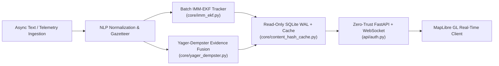
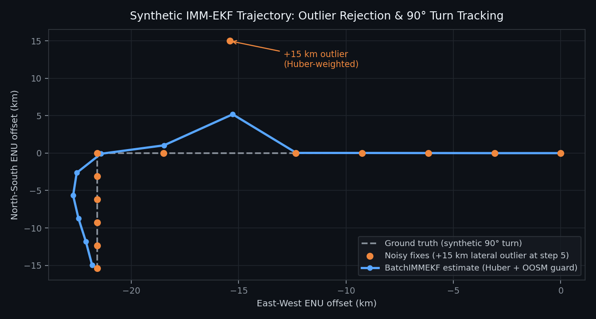

# bayes-track-core

[](https://github.com/razin-core/bayes-track-core/actions/workflows/ci.yml)

Sanitized, domain-agnostic mathematical and systems core extracted from a private real-time multi-source OSINT geospatial tracking & risk-estimation engine.

> **OPSEC & Scope Note:** This public repository intentionally contains **only** the pure tracking math, evidence fusion, caching, zero-trust API auth, and synthetic tests. Live ingestion feeds, operational gazetteers, real coordinates, and private keys are excluded.

## Architecture Overview



## Included Modules

- **`core/imm_ekf.py`** — Vectorized Interacting Multiple Model Extended Kalman Filter (`BatchIMMEKF`) with:
  - Huber-style robust outlier weighting (`+15 km` lateral spike rejection without destabilizing course);
  - Out-of-Sequence Measurement (OOSM) backward-fix guard (ignores single stale/delayed behind-track fixes while still following real `180°` reversals and `90°` turns);
  - Cross-wind drift propagation during `COASTING` under degraded navigation.
- **`core/models.py`** — WGS84 ↔ local tangent-plane ENU coordinate transforms (`wgs84_to_enu`, `enu_to_wgs84`) and typed `Observation` / `Track` dataclasses.
- **`core/yager_dempster.py`** — Yager-modified Dempster-Shafer belief fusion with echo suppression and novelty discounting for correlated noisy observers.
- **`core/content_hash_cache.py`** — Path-independent SHA-256 content-hash cache for expensive parsing/inference stages.
- **`api/auth.py`** — Zero-trust FastAPI dependency (`verify_api_key`) featuring:
  - Strict reverse-proxy header detection (`CF-Connecting-IP`, `CF-Ray`, `X-Forwarded-For`, etc.) so proxied requests can never spoof `localhost`;
  - Constant-time key matching (`secrets.compare_digest`) with hot-reloading by `mtime`;
  - Bounded sliding-window per-key rate limiter (`HTTP 429`).

## Quickstart & Synthetic Test Suite

```bash
python3 -m venv .venv
source .venv/bin/activate
pip install -r requirements.txt
pytest -v
```

All tests run on synthetic coordinates (`(49.0, 30.0)`) and temporary JSON keyfiles — no external services or network access required.

## Mathematical Formulation

### 1. Robust IMM-EKF Update (`core/imm_ekf.py`)
Given predicted state $\hat{\mathbf{x}}_{k|k-1}$ and innovation $\mathbf{y}_k = \mathbf{z}_k - \mathbf{H}\hat{\mathbf{x}}_{k|k-1}$, measurement covariance $\mathbf{R}_k$ is inflated via a Huber-style weight for large Mahalanobis distances $d_k = \sqrt{\mathbf{y}_k^\top \mathbf{S}_k^{-1} \mathbf{y}_k}$:

$$\mathbf{K}_k = \mathbf{P}_{k|k-1}\mathbf{H}^\top\left(\mathbf{H}\mathbf{P}_{k|k-1}\mathbf{H}^\top + \tilde{\mathbf{R}}_k\right)^{-1}, \qquad \hat{\mathbf{x}}_{k|k} = \hat{\mathbf{x}}_{k|k-1} + \mathbf{K}_k \mathbf{y}_k$$



### 2. Yager-Modified Dempster-Shafer Fusion (`core/yager_dempster.py`)
Over the binary frame $\Theta = \{\text{THREAT}, \text{CLEAR}\}$, pairwise conflict mass $K = m_1(T)m_2(C) + m_1(C)m_2(T)$ is routed into full ignorance $m_{12}(\Theta)$ instead of dividing by $(1 - K)$, eliminating Zadeh's paradox:

$$m_{12}(T) = m_1(T)m_2(T) + m_1(T)m_2(\Theta) + m_1(\Theta)m_2(T), \qquad m_{12}(\Theta) = m_1(\Theta)m_2(\Theta) + K$$
